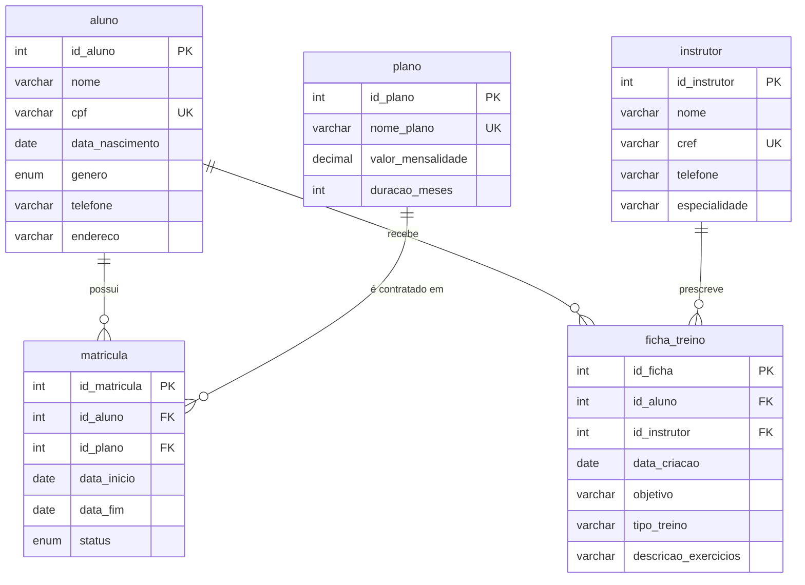

# 🏋️ Academia FitLife — Banco de Dados Relacional


Banco de dados relacional da **Academia FitLife**, um centro de saúde e bem-estar com musculação, aulas coletivas e personal trainers. O projeto troca planilhas isoladas e fichas de papel por um banco centralizado que apoia o dia a dia da **recepção**, dos **instrutores** e da **gerência**.

> Projeto acadêmico da disciplina **Banco de Dados Relacionais** do curso de Engenharia de Software da **Universidade de Vassouras – Campus Maricá**, ministrada pelo professor Rafael Minsen.

---

## 📌 Sobre o projeto

| Etapa | Entrega |
|---|---|
| **T1** | Levantamento com os stakeholders (recepcionista, instrutor, aluno e gerente), funcionalidades, entidades e Diagrama Entidade-Relacionamento (DER) |
| **T2** | Implementação física (DDL), povoamento com dados fictícios (DML) e quatro análises de dados para apoiar a tomada de decisão |

Tudo está em um único script: [`BD_FitLife.sql`](BD_FitLife.sql).

---

## 🗂️ Modelo de dados



| Tabela | Tipo | Descrição |
|---|---|---|
| `aluno` | Cadastro | Dados pessoais e de contato dos clientes |
| `plano` | Cadastro | Catálogo de planos, com mensalidade e duração |
| `instrutor` | Cadastro | Profissionais e registro no conselho (CREF) |
| `matricula` | Transação | Vínculo aluno × plano, com vigência e status (`Ativa`, `Inadimplente`, `Vencida`, `Cancelada`) |
| `ficha_treino` | Transação | Treinos prescritos por um instrutor para um aluno |

### 🔒 Regras de integridade

- **PRIMARY KEY** com `AUTO_INCREMENT` em todas as tabelas
- **FOREIGN KEY** em `matricula` (→ `aluno`, `plano`) e `ficha_treino` (→ `aluno`, `instrutor`)
- **UNIQUE** em CPF, CREF e nome do plano
- **CHECK**: mensalidade e duração maiores que zero, e `data_fim` posterior a `data_inicio`
- **ENUM** para domínios fechados (gênero e status da matrícula)
- **DECIMAL(10,2)** para valores monetários

---

## 📊 Dados fictícios

| Tabela | Registros |
|---|---:|
| `aluno` | 20 |
| `plano` | 10 |
| `instrutor` | 10 |
| `matricula` | 56 |
| `ficha_treino` | 50 |
| **Total** | **146** |

Os dados foram montados para fazer sentido para o negócio:

- 📅 As matrículas vão de jan/2025 a nov/2026, e as renovações de um mesmo aluno não se sobrepõem.
- 💳 Os status combinam com a data de referência: 11 ativas, 4 inadimplentes, 38 vencidas e 3 canceladas.
- 💰 As mensalidades vão de R$ 74,90 a R$ 349,90, em planos de 1, 3, 6 e 12 meses.
- 👵 O plano Melhor Idade só foi vendido para alunos acima de 60 anos, e o Estudante para alunos de 21 a 25 anos.
- 🛡️ Os CPFs têm dígitos verificadores propositalmente inválidos, para não coincidir com documentos reais (LGPD).

---

## 🔎 Análises

| | Pergunta de negócio | Técnica | Stakeholder |
|---|---|---|---|
| **A** | Quem tem contrato vigente hoje, em qual plano, quando vence e se está em dia? | `INNER JOIN` com 3 tabelas | Recepcionista |
| **B** | Quais planos venderam 5 ou mais matrículas, e com qual receita e ticket médio? | `COUNT`, `SUM`, `AVG` + `GROUP BY` + `HAVING` | Gerente |
| **C** | Quem está sem contrato regular, qual foi o último plano e há quantas matrículas é cliente? | CTE (`WITH`) | Gerente |
| **D** | Qual é a ficha de treino mais recente de cada aluno e há quantos dias não é atualizada? | `ROW_NUMBER()` e `COUNT()` com `OVER (PARTITION BY)` | Instrutor |

### 💡 O que os dados mostram

- **A:** 4 dos 15 alunos com contrato vigente estão inadimplentes e devem passar pelo financeiro antes de entrar.
- **B:** o plano Mensal é o mais vendido (9 matrículas), mas gera a menor receita (R$ 1.079,10). O FitPlus Anual lidera com R$ 8.394,00.
- **C:** 9 dos 20 alunos (45%) estão sem contrato regular: 4 inadimplentes para a cobrança e 5 ex-alunos para a campanha de reativação.
- **D:** 7 dos 15 alunos com contrato vigente estão com a ficha parada há mais de 90 dias. O caso mais antigo tem 225 dias.

<details>
<summary><b>Exemplo: Análise D (window function)</b></summary>

```sql
WITH fichas_ordenadas AS (
    SELECT f.id_aluno,
        f.id_instrutor,
        f.data_criacao,
        f.objetivo,
        f.tipo_treino,
        ROW_NUMBER() OVER (PARTITION BY f.id_aluno
            ORDER BY f.data_criacao DESC) AS ordem_recente,
        COUNT(*) OVER (PARTITION BY f.id_aluno) AS total_fichas
    FROM ficha_treino f
)
SELECT a.nome AS aluno,
    i.nome AS instrutor,
    fo.objetivo,
    fo.tipo_treino,
    fo.data_criacao AS ultima_ficha,
    DATEDIFF('2026-11-12', fo.data_criacao) AS dias_sem_atualizar,
    fo.total_fichas
FROM fichas_ordenadas fo
INNER JOIN aluno a ON a.id_aluno = fo.id_aluno
INNER JOIN instrutor i ON i.id_instrutor = fo.id_instrutor
WHERE fo.ordem_recente = 1
    AND fo.id_aluno IN (SELECT id_aluno
        FROM matricula
        WHERE status IN ('Ativa', 'Inadimplente')
            AND '2026-11-12' BETWEEN data_inicio AND data_fim)
ORDER BY dias_sem_atualizar DESC;
```

</details>

> 📆 As consultas usam a data de referência fixa **12/11/2026**, para que os resultados sejam sempre os mesmos. Em produção, basta trocar `'2026-11-12'` por `CURDATE()`.

---

## ▶️ Como executar

**Requisito:** MySQL 8.0 ou superior. As restrições `CHECK` são aplicadas a partir da versão 8.0.16, e as CTEs e window functions existem desde a 8.0.

> ⚠️ O script começa com `DROP SCHEMA IF EXISTS academia_fitlife`, então ele apaga e recria o banco a cada execução.

**MySQL Workbench**

1. Abra o arquivo `BD_FitLife.sql`.
2. Execute o script inteiro (`Ctrl + Shift + Enter`).
3. Cada consulta abre o resultado em uma aba própria.

**Terminal**

```bash
git clone https://github.com/DanielMonteiroC/Academia_FitLife_BD.git
cd Academia_FitLife_BD
mysql -u root -p < BD_FitLife.sql
```

### 🧪 Testes de integridade

No final do script há quatro comandos comentados que **devem ser recusados** pelo MySQL. Tire o comentário de um por vez para testar:

| Teste | Erro esperado |
|---|---|
| Matrícula para um aluno que não existe | `ERROR 1452` (FK `fk_matricula_aluno`) |
| Matrícula com um plano que não existe | `ERROR 1452` (FK `fk_matricula_plano`) |
| Plano com mensalidade negativa | `ERROR 3819` (CHECK `ck_plano_valor`) |
| Exclusão de um aluno com matrículas e fichas | `ERROR 1451` (FK `fk_ficha_aluno`) |

---

## 📁 Estrutura do repositório

```
Academia_FitLife_BD/
├── BD_FitLife.sql   # DDL + DML + análises + testes de integridade
└── README.md
```

---

## 👤 Autor

**Daniel Monteiro de Carvalho**
Engenharia de Software · Universidade de Vassouras – Campus Maricá
